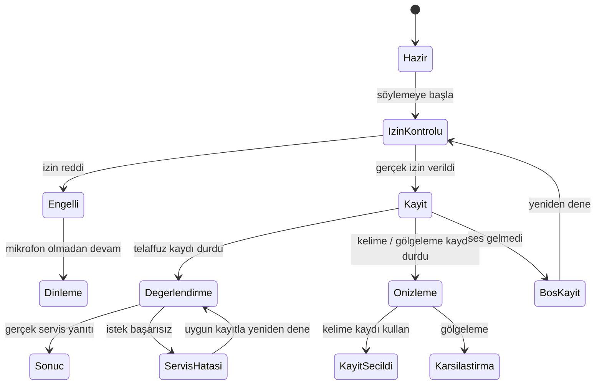

# Bileşen ve durum sözleşmesi

## Ortak anatomi

1. Çalışma türü ve hedef dil.
2. Literata ile hedef kelime/cümle, altında Türkçe anlam.
3. Model sesi dinleme.
4. Durum paneli: açık başlık + bir açıklama + ana eylem + ikincil çıkış.
5. Sonuç varsa tek çalışma önerisi, kelime ayrıntıları ve isteğe bağlı alt puanlar.

Önerilen üretim bileşen sınırları: `VoiceTarget`, `VoiceStatePanel`, `RecordingControls`, `PronunciationSummary`, `WordFeedbackDetails`, `ListeningRounds`. Bunlar bu pakette React olarak uygulanmış değildir; mevcut bileşenlere uyarlanacak tasarım sınırlarıdır. Yeni genel framework veya ses altyapısı kurulması gerekmiyor.

## Üç farklı kayıt sözleşmesi

| İşlem | Gerçek mevcut sınır | Kayıt sonrası | Puan |
|---|---|---|---|
| Kelime kaydı | 8 sn | Dinle → yeniden kaydet / bu kaydı kullan | Yok |
| Telaffuz | 12 sn | Mevcut akışta servis değerlendirmesi | Gerçek servis verisi |
| Gölgeleme | Metin süresine bağlı, 2,5–15 sn | Model ve kendi kaydını sırayla karşılaştır | Yok |

Prototipte gölgeleme süresi mevcut answerMs mantığına göre örnek metin için hesaplanır ve üst saniyeye yuvarlanır. Gerçek uygulama ms hassasiyetini korumalı. Simülasyon sayacı performans saatinden ilerler; gerçek kayıt süresi ve native media zamanı yerine kullanılmamalı.

## Durumların akışlara dağılımı

| Akış | Durumlar |
|---|---|
| Telaffuz | ready, permission, recording, checking, success, needspractice, blocked, unsupported, empty, serviceerror, audioloading, audioerror |
| Kelime kaydı | ready, permission, recording, review, saved, blocked, unsupported, empty |
| Gölgeleme | ready, hearing, permission, recording, review, blocked, unsupported, empty, audioerror |
| Dinleme | ready, audioloading, audioerror, unsupported |

## Eylem haritası

Bu şema üretimde hedeflenen davranışı anlatır. Prototipte izin ve değerlendirme adımları açık simülasyondur. İzin zaten varsa gerçek tarayıcı yeniden izin penceresi açmayabilir; yapay bir izin adımı dayatılmamalı. Gölgelemede model sesinin tamamlanmasından sonra kayıt/izin işlemi başlar; ses desteği yoksa mikrofona geçilmez.

## Geri bildirim

Örnek 82/54 puanları ve 85/74/90 alt puanları statiktir. Gerçek kullanıcıyla ilişkilendirilemez. Yeşil ve turuncu sadece örnek cevap/sözcük geribildirimi alanında kullanıldı; kayıt göstergesi ayrı token. Detayda okunur durum metni bulunur; renk tek gösterge değildir.

Örnek tavsiye bilimsel fonem teşhisi değildir. Gerçek öneri yalnız servis sonucu ve mevcut PronTips koşullarıyla verilmeli. API anahtarı yokken YZ tavsiyesi hazırlanıyormuş gibi gösterilmemeli.

## Hareket ve erişilebilirlik

Kayıt halkası hafif nabız; bekleme halkası döner. Sakin ve reduced-motion bunları durdurur; kayıt/işlem metni kalır. Her zaman erişilebilir durdur/iptal seçeneği olmalı. Sayaç her yarım saniyede ekran okuyucuya duyurulmamalı. Gerçek asenkron durum değişimleri üretimde tek ve uygun canlı duyuruyla bağlanmalı; bu prototipte her timer tick için canlı duyuru yok.

Sözcük detayında native dialog, Escape ve açık kapat düğmesi var. Gerçek uygulamada hedefe dönüş odağı ve asenkron sonuç odağı ekran okuyucuyla ayrıca sınanmalı. Dil/vurgu seçicisi yalnız tasarım kontrolüdür; örnek içerik İspanyolca kalır.
